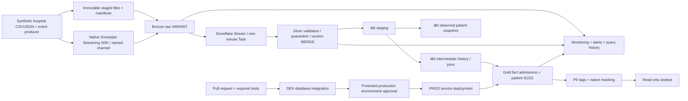

# Final architecture

DEV and PROD have separate databases, warehouses and credentials; the data path is repeated inside each environment. No production arrow originates from an ordinary engineer SQL session. Source-file hash manifests/COPY history and local producer checkpoints mark restart boundaries. MONITORING observes each layer and runtime; benchmarks use frozen DEV Gold only.

Native streaming is currently opt-in DEV code: stable channel identity, retained source hashes and committed offsets provide its recovery boundary. PROD continues through the protected deployment path; adding native PROD ingestion requires a reviewed deployment and a restricted ingestion identity. The native producer deliberately cannot select PROD. Gold updates run through dbt at a configured interval, not at each event.

Rendered architecture_diagram.svg and architecture_diagram.png are authored architecture illustrations, not fabricated execution screenshots. role_hierarchy_diagram.svg/png depicts role inheritance. Actual lineage screenshots must be captured separately from dbt/Snowflake.
