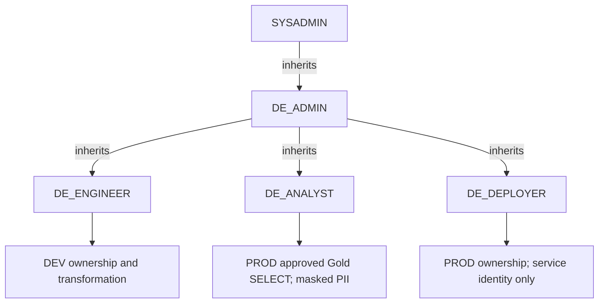

# Role hierarchy and access proof

Roles are siblings under DE_ADMIN. A parent inherits the child; the child never inherits the parent. DE_ENGINEER does not inherit DE_DEPLOYER. SYSADMIN inherits DE_ADMIN for authorized setup; ordinary analyst/engineer users must not hold SYSADMIN, ACCOUNTADMIN, SECURITYADMIN or equivalent roles.

| Role | DEV | PROD Bronze/Silver/intermediate | PROD approved Gold | PII / intended identity |
|---|---|---|---|---|
| DE_ADMIN | inherited management | inherited management | administrative management | real values only when active; authorized admin |
| DE_ENGINEER | owns DEV; read/write/transform | denied | denied | synthetic DEV values; ordinary engineer |
| DE_ANALYST | denied | denied | SELECT only on dim_patients/fct_admissions | masked; distinct analyst user |
| DE_DEPLOYER | denied unless separately configured | owns PROD, automated changes | automated create/merge | masked by policy; protected service identity |

Owning a database is intentionally bounded to its environment. Owners/deployer can change policies or access raw data, so protecting the service key is part of the trust boundary. The guarantee is no ordinary engineer/analyst manual PROD write access, not an assertion that Snowflake account administrators cannot intervene. Emergency data/model changes still use fast-track approved PR and pipeline.

Test matrix: administrator reads patient 1 real values; analyst reads same patient 1 masked values; analyst UPDATE Gold denied; analyst raw Bronze/Silver/intermediate PII read denied; analyst DEV write denied; engineer PROD UPDATE denied; analyst cannot USE ROLE DE_ADMIN/DE_DEPLOYER/DE_ENGINEER; engineer cannot activate admin/deployer. hospital.security_check asserts results with three distinct users and USE SECONDARY ROLES NONE. Zero-row UPDATE verifies privilege without changing data even if a misgrant is found.

Before testing, review SHOW GRANTS TO USER for each test identity, SHOW GRANTS TO ROLE and recursively inherited roles, SHOW GRANTS OF ROLE, grants on PUBLIC and object ownership. Active and secondary roles matter. A test under an analyst role on an administrator user does not prove that user cannot switch roles. USER-level and database roles must be reviewed in addition to these four role definitions.
